<!-- Generated by GitHub Profile Agent Console. Edit profile.config.json, then run npm run generate. -->

  <picture>
    <source media="(max-width: 760px) and (prefers-color-scheme: dark)" srcset="./assets/hero/agent-console-dfb94a57-mobile-dark.svg">
    <source media="(max-width: 760px)" srcset="./assets/hero/agent-console-dfb94a57-mobile-light.svg">
    <source media="(prefers-color-scheme: dark)" srcset="./assets/hero/agent-console-dfb94a57-dark.svg">
    <source media="(prefers-color-scheme: light)" srcset="./assets/hero/agent-console-dfb94a57-light.svg">
    
  </picture>

  

## About Me

I create fun things, often related to libraries and digital literacy.

I create things that combine effectiveness with fun. Things that make life easier in various fields, especially in libraries.

## Current Focus

| Area | What I am exploring |
| --- | --- |
| **Library** | library automation, library applications, and the use of tools. |
| **Automation** | Library management has been automated. |
| **AI Applications** | AI Integration in Library Management. |

## Featured Work

| Project | Focus | Why it matters |
| --- | --- | --- |
| [**DDC Finder**](https://github.com/Indrasetyapermana/ddcfinder) | Library Automation | simplifies the classification of library collections based on the DDC. |

## Research Direction

I am interested in systems that simplify library management and digital literacy.

## Tech Stack

`PHP` · `PostgreSQL` · `Python` · `TypeScript`

## Recent Activity

<!-- AUTO:ACTIVITY:START -->
_Recent public activity will appear here after the workflow runs._
<!-- AUTO:ACTIVITY:END -->

---

  Ordinary Person

